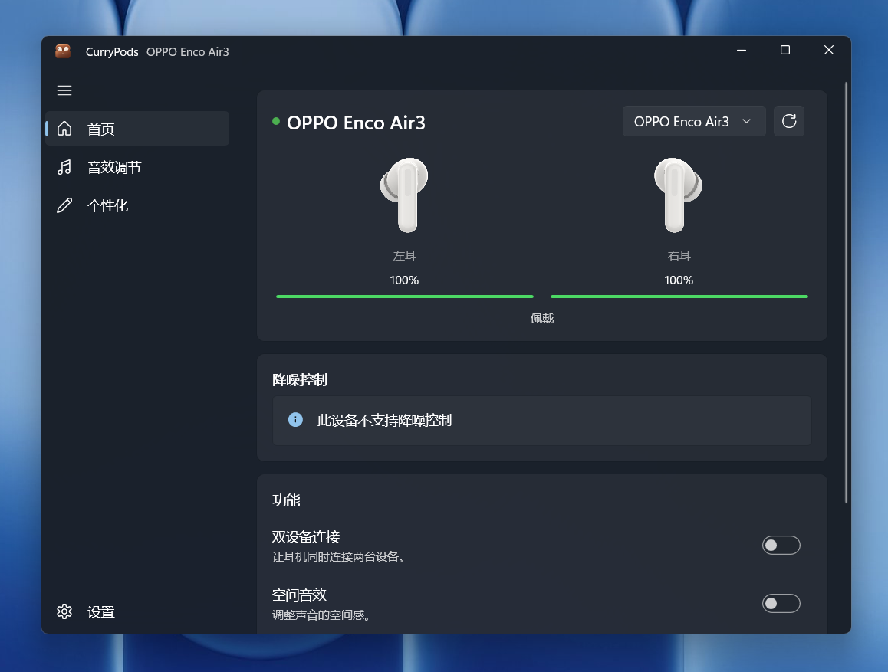

# CurryPods 💩

使用 Windows App SDK / WinUI 3 开发的原生 Windows 的 OPPO 耳机管理器。

从 [Zhaoyi-ya/OppoPodsManager](https://github.com/Zhaoyi-ya/OppoPodsManager) 的 Avalonia 版本迁移而来。

名称来源：Microsoft 已经被印度人占领，Windows 充满了草台班子般的 Bug 和设计。所以给 Windows 开发的原生程序自然就是咖喱风味（Curry）的。

## 预览



## 环境要求

- .NET Runtime 10：直接 `scoop install dotnet-sdk` 就没毛病了。

- Windows 11：最低什么版本我不记得了。

## 开发要求

喜报！现在（2026.10）开发 Windows App SDK 不用再安装巨无霸 Visual Studio 了，仅仅需要安装 WinApp CLI 就能进行管理和编译：

```powershell
winget install Microsoft.winappcli --source winget
```

更多有关 WinApp CLI 的文档请见：[Windows App Development CLI](https://learn.microsoft.com/en-us/windows/apps/dev-tools/winapp-cli/)